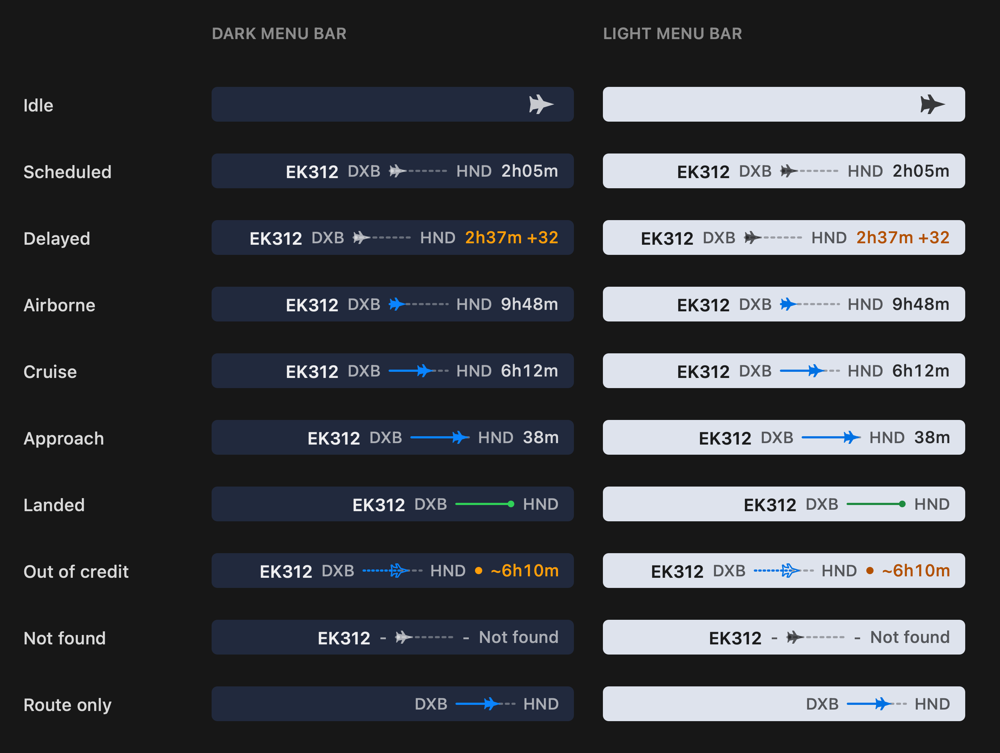
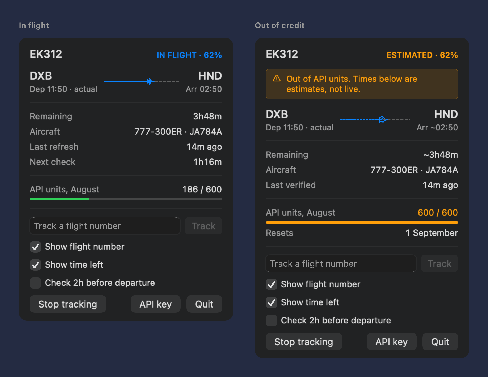

# Hatrack

A flight's progress in the macOS menu bar. Give it a flight number and it draws the journey: origin, a track the aircraft rides, destination, time left. Blue while airborne, green once it's down.

**[Download Hatrack.pkg](https://github.com/ksuh90/hatrack/releases/latest/download/Hatrack.pkg)** (macOS 14+) and open it to install Hatrack in /Applications.
The first time, macOS blocks it because it is not notarized: right-click the .pkg and choose Open (if no Open button appears, click Open Anyway in System Settings > Privacy & Security).
Then start Hatrack from Spotlight or Finder.



Enter a flight number and pick which day to follow - today out to three days ahead - from a small departure board. Click the item for detail.



## Install

Download the installer above, or build from source. Building requires macOS 14+ and the Swift toolchain (Xcode Command Line Tools are enough).

```sh
git clone https://github.com/ksuh90/hatrack.git
cd hatrack
./Scripts/build-app.sh
open Hatrack.app
```

Then click the menu bar item, paste an [AeroDataBox](https://rapidapi.com/aedbx-aedbx/api/aerodatabox) RapidAPI key (free tier), and type a flight number.

Always start the app with `open` (or from Finder or Spotlight; `open -n` for a second copy), never by running `Hatrack.app/Contents/MacOS/Hatrack` from a shell: macOS files a menu bar item under whichever app launched it first, so a shell launch leaves Hatrack's icon under your terminal's switch in System Settings > Menu Bar > Allow in the Menu Bar.

The key is stored in your Keychain. The first time a build reads it, macOS asks; choose Always Allow and later rebuilds keep that permission.

### Local signing

The first build creates a self-signed code-signing certificate, "Hatrack Local Signing", in your login keychain, and every build after that signs with it. Each rebuild is then the same app to macOS: one Hatrack row in the menu bar settings, and no new Keychain prompt per build. Only `codesign` may use the certificate's key, so building needs no password. If the certificate cannot be used (for example, the login keychain is locked), the build signs ad hoc and says so.

To remove it:

```sh
security delete-identity -c "Hatrack Local Signing" ~/Library/Keychains/login.keychain-db
```

## Frugal by design

AeroDataBox's free tier is 600 units a month; a dated status lookup costs 2 and the range call that lists your date options costs 6. Hatrack aims well under that:

- One range call lists the next few days when you add a flight; the day you pick is seeded from it, so choosing costs nothing more
- After that only the picked date is ever re-checked - a dated lookup, never a fresh search
- **Nothing** is spent until the scheduled departure - flights don't leave early
- The first poll fires ten minutes past the scheduled time and either finds it airborne or reads the new estimate and sleeps again; a delay costs one call, not a cadence
- Cruise every 90 minutes, the last 45 minutes every 20, then one call to confirm touchdown

About 12 calls for a long-haul, 6 for a short hop. Between calls the bar interpolates off the clock, so it keeps moving for free. It also tracks its own spend and refuses to exceed the monthly cap - when it does, the bar keeps moving but marks itself estimated, and the dropdown says so.

## Options

Show or hide the flight number and the time left; the route is always drawn. An optional check two hours before departure warns of a delay before you leave for the airport, at one extra call.

If the menu bar is full, macOS parks an oversized item under the notch where it is invisible. Hatrack measures its own placement and drops detail until it fits - time left, then airport codes, then flight number - and restores itself when space returns.

## Development

```sh
swift build
./.build/debug/Hatrack --self-check                  # polling policy, progress maths, input validation
./.build/debug/Hatrack --render-states out.png       # every bar state, both appearances
./.build/debug/Hatrack --render-panel out.png        # the dropdown, offscreen
HATRACK_DEMO=1 ./.build/debug/Hatrack                # a synthetic flight, no API key needed
HATRACK_DIAG=1 ./.build/debug/Hatrack                # log menu bar placement decisions
```

Swapping data providers means writing one `FlightProvider` and changing one line in `Coordinator.provider`; nothing else knows where flights come from.

The screenshots above are generated by the app itself, so they cannot drift from what it actually draws.

### Releases

Pushing a version tag (`git tag v1.2.3 && git push origin v1.2.3`) runs `.github/workflows/release.yml` on a GitHub-hosted Mac: it builds the app with `Scripts/build-app.sh`, packages it with `Scripts/build-pkg.sh`, and attaches `Hatrack.pkg` to that tag's GitHub Release, which the Download link above always points to. Running the workflow by hand (Actions > Release > Run workflow) builds the same package as a workflow artifact without releasing anything.

The package only installs the app; it never launches it, because a launch from the installer runs as root and could file the menu bar item under the wrong app.

Released builds should carry the same "Hatrack Local Signing" certificate as local builds, so macOS keeps treating every version as the same app. The workflow reads it from two repository secrets; without them it signs ad hoc and says so in the job log and the release notes. To set them up, from the Mac that holds the certificate:

1. Open Keychain Access, select the login keychain and the My Certificates tab, right-click "Hatrack Local Signing" and choose Export. Save it as `hatrack-signing.p12` with a strong password (macOS asks for your login password to allow exporting the key).
2. Store it and its password as secrets, then delete the file:

   ```sh
   base64 -i hatrack-signing.p12 | gh secret set HATRACK_SIGNING_P12 --repo ksuh90/hatrack
   gh secret set HATRACK_SIGNING_P12_PASSWORD --repo ksuh90/hatrack   # paste the password
   rm hatrack-signing.p12
   ```

Export from Keychain Access rather than `security export`, which writes every identity in the keychain, not just this one. The job imports the certificate into a temporary keychain, deletes it when done, and fails if the secrets are set but the app did not end up signed with them.

## License

MIT
